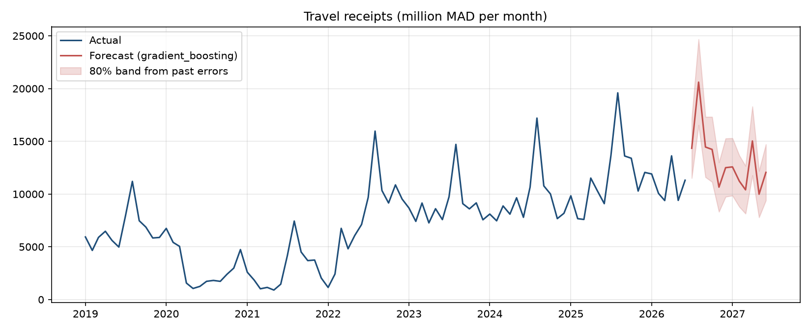
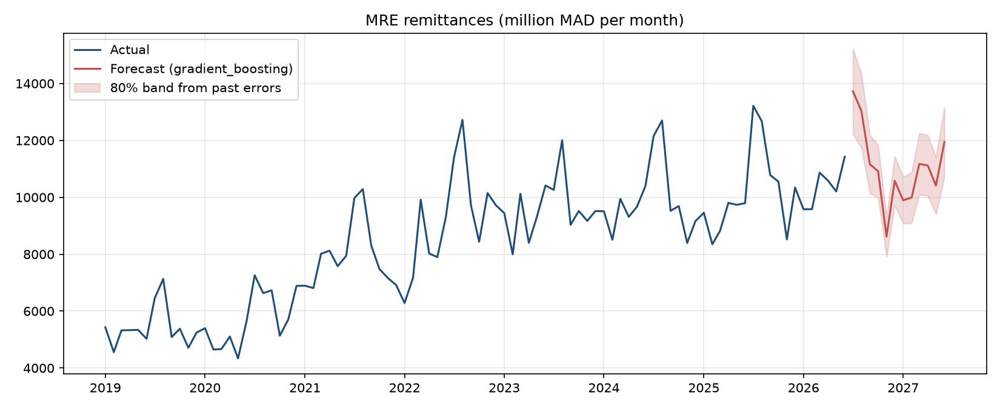
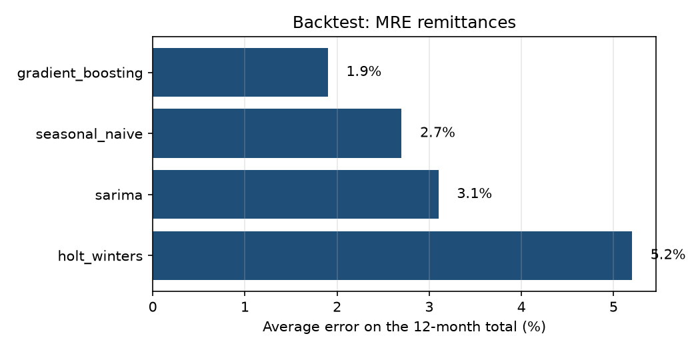
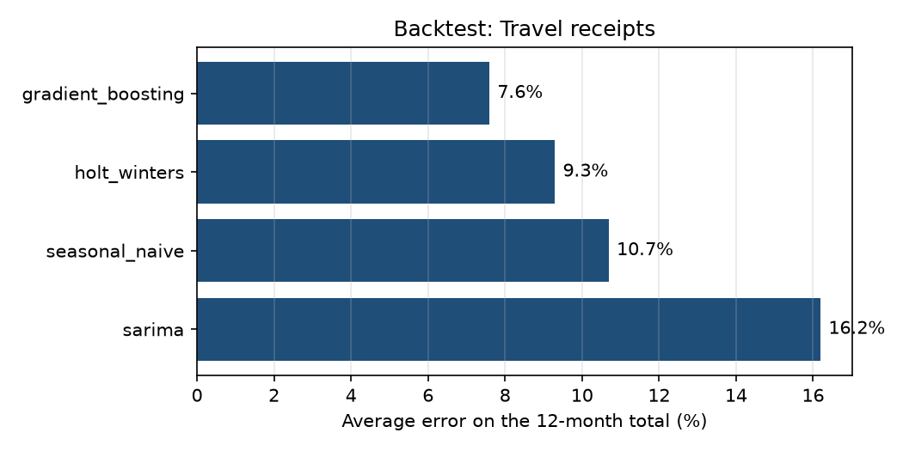

# Morocco External Flows Forecasting

Forecasts two key indicators of Morocco's external accounts for the next
12 months, using official monthly data from the **Office des Changes**
(2004 to 2026):

- **MRE remittances**: money sent home by Moroccans Resident Abroad
- **Travel receipts**: foreign currency spent by tourists in Morocco

Four models are compared on past data they never saw. The best one uses
**Eid dates**, which move about 11 days earlier every year.




## Results

Average error over 25 backtests (each model trained up to a month,
then compared with the 12 months that really followed):

| Series          | Best model        | Monthly error | Error on 12-month total |
| --------------- | ----------------- | ------------- | ----------------------- |
| MRE remittances | Gradient boosting | 5.9%          | **1.9%**                |
| Travel receipts | Gradient boosting | 14.0%         | **7.6%**                |

Forecast for July 2026 to June 2027:

- MRE remittances: **132.6 billion MAD**
- Travel receipts: **158.1 billion MAD**




## Key findings

- **Remittances nearly doubled** between 2019 (65 billion MAD) and 2025
  (122 billion MAD).
- **Tourism collapsed in 2020–2021** (COVID border closures), then
  reached a record 139 billion MAD in 2025.
- **The Moroccan calendar matters:** remittances and travel spike around
  Eid al-Fitr and Eid al-Adha. Since Eid shifts by about 11 days a year,
  a model that only knows "the month" misses the effect. Adding Eid
  months as features gave the most accurate model on both series.
- **A simple baseline is hard to beat:** "same month last year" is
  almost as good as the best model on monthly values. Complex models
  must be compared against it, not assumed better.

## Models

| Model             | Idea                                                       |
| ----------------- | ---------------------------------------------------------- |
| Seasonal naive    | Each month = same month last year (baseline)               |
| Holt-Winters      | Exponential smoothing with trend and monthly seasonality   |
| SARIMA            | Seasonal ARIMA on log values, with Eid and COVID inputs    |
| Gradient boosting | Learns year-on-year growth per month from Eid and calendar |

COVID months (March 2020 to January 2022) are handled explicitly:
as an input for SARIMA, and excluded from training for gradient boosting.

## Data quality

Before any modeling, the pipeline checks that:

- Monthly values add up to the yearly totals published in the same file
- No month is missing between 2004 and the latest month
- No value is zero or negative

## Project structure

```
├── data/
│   ├── raw/            Office des Changes Excel files
│   └── processed/      Clean monthly CSV files
├── flows/
│   ├── oc_excel.py           Reads the Office des Changes table layout
│   ├── validate.py           Data quality checks
│   ├── prepare_data.py       Excel → clean CSV
│   ├── calendar_features.py  Eid months (Hijri calendar) and COVID flag
│   ├── models/               The 4 forecasting models
│   ├── backtest.py           Rolling-origin comparison of the models
│   ├── forecast.py           12-month forecast with the best model
│   └── plots.py              Charts
└── reports/            Backtest results, forecasts, figures
```

## Run it

```bash
python3 -m venv .venv
source .venv/bin/activate
pip install -r requirements.txt

python -m flows.prepare_data
python -m flows.backtest
python -m flows.forecast
```

## Data source

[Office des Changes, Séries statistiques](https://www.oc.gov.ma/fr/etudes-et-statistiques/series-statistiques):
_Evolution mensuelle des recettes MRE_ and
_Evolution mensuelle des recettes Voyages_ (raw, not seasonally adjusted).
